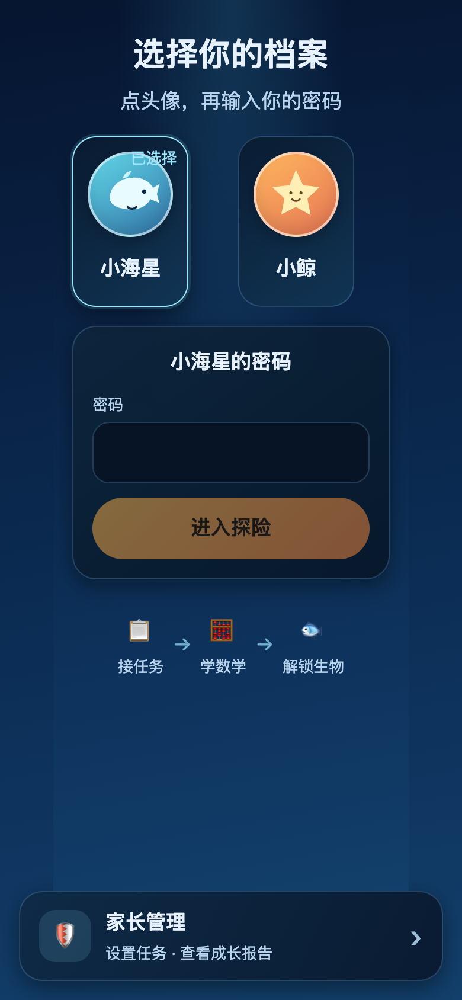
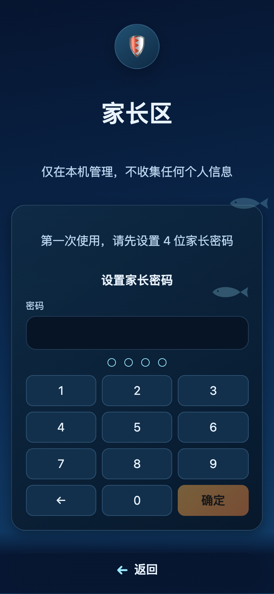
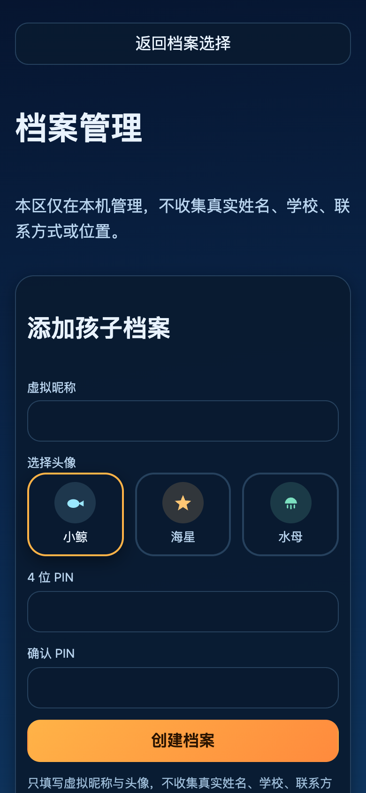
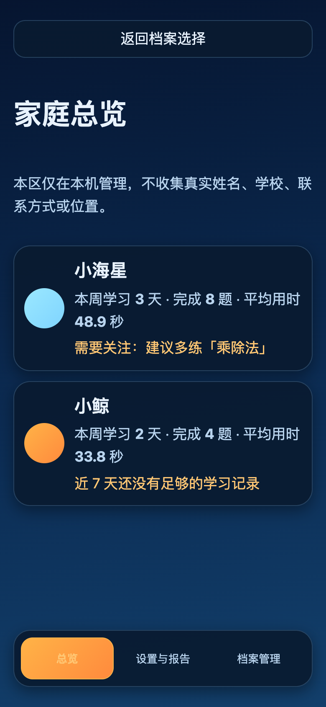
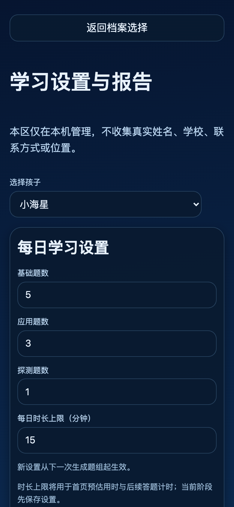
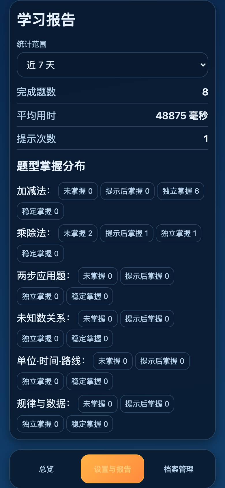
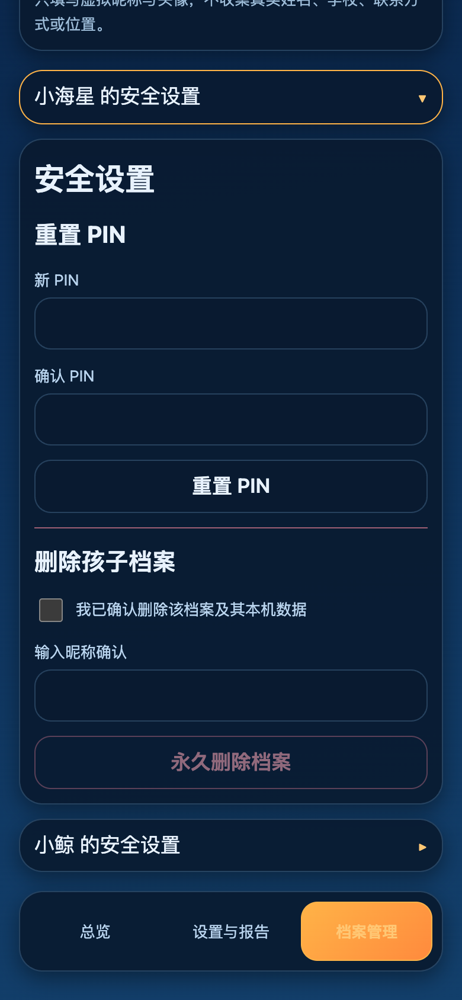

# 深海数学探险 · 家长操作手册

> 版本：v2.0 ｜ 最后更新：2026-10-22 ｜ 适用版本：阶段二（DSM2001） ｜ 负责人：DSM1234 实施组 ｜ 核对：已按线上界面逐页核对

本手册写给家长，覆盖建档、每日使用、家长区设置与报告、PIN 管理、数据安全与常见问题。孩子端不需要阅读本手册；孩子只需要选自己的头像、输入自己的 4 位 PIN，然后开始答题。

手册中的截图使用示例昵称与示例数据，实际界面以你手机上的显示为准。

## 目录

1. [先了解三件事](#1-先了解三件事)
2. [第一次使用：从建档到开始第一组题](#2-第一次使用从建档到开始第一组题)
3. [孩子每天怎么用](#3-孩子每天怎么用)
4. [家长区三个页面](#4-家长区三个页面)
5. [两个 PIN 与数据安全](#5-两个-pin-与数据安全)
6. [常见问题](#6-常见问题)
7. [使用建议与当前版本边界](#7-使用建议与当前版本边界)

## 1. 先了解三件事

1. **每天一组数学题。** 默认 4 道基础题、4 道应用题、1 道探测题，共 9 道；题量可在家长区调整。完成整组后解锁图鉴收藏与下潜区域。
2. **奖励绑定在“完成整组 + 独立答对率”上。** 答错不会回退已解锁内容；用过提示的题不计“独立掌握”；独立答对率达到总题数的 60% 会额外获得“独立掌握徽章”。
3. **数据只在这台设备的这个浏览器里。** 没有账号、没有云端同步、没有第三方分析 SDK；换设备、换浏览器或清除网站数据，进度不会跟过去。

## 2. 第一次使用：从建档到开始第一组题

### 2.1 打开应用

建议用手机的系统浏览器（Safari、Chrome、Edge 等）打开，竖屏使用。地址是：

```text
https://wangdonghello.github.io/deep-sea-math/
```

建议把这个地址收藏到浏览器书签或添加到手机主屏幕，孩子下次可以直接打开。

不要优先用微信内置浏览器打开：`github.io` 域名在微信内可能被拦截，表现为白屏、一直转圈或提示无法访问。遇到这种情况，复制链接到系统浏览器打开即可。

首次打开会进入“选择你的档案”页。还没有档案时，页面会提示“请家长先创建一个学习档案”，底部有一张“家长管理”卡片。



### 2.2 进入家长区，设置家长密码

1. 点档案选择页底部的“**家长管理**”。
2. 第一次进入会看到“第一次使用，请先设置 4 位家长密码”。
3. 输入 4 位数字，再输一次确认，点“**确定**”。



家长密码只用于进入家长区，和孩子的 PIN 不是同一个密码。请记在家长自己能找到的地方：**家长密码没有找回入口**，忘记后只能清除本站点数据重新开始，所有孩子档案与进度会一起丢失。

### 2.3 创建孩子档案

1. 进入家长区后，点底部“**档案管理**”。
2. 在“添加孩子档案”里填写：
   - **虚拟昵称**：最多 24 个字。建议用“小海星”“小鲸”这类昵称，不要填真实姓名。
   - **年级**：一年级、二年级、三年级。题目会严格按这个年级抽取。
   - **兴趣主题**：深海、恐龙、太空。主题影响图鉴收藏；三年级题目固定为洛克王国文字主题。
   - **头像**：小鲸、海星、水母三选一。
   - **4 位 PIN** 与**确认 PIN**：孩子下次登录用，两次必须相同。
3. 点“**创建档案**”。成功后页面提示“孩子档案已创建，请返回档案选择页开始探索。”



一个孩子建一个档案。多个孩子请分别建档，进度、错题和图鉴互相隔离。

建好档案后，展开档案卡片可以修改**年级**和**兴趣主题**。修改只影响下一组任务，当前正在做的题组不会中途换题。

### 2.4 孩子登录并领取第一组题

1. 点家长区顶部的“**返回档案选择**”。
2. 点孩子的头像，输入刚才设置的 4 位孩子 PIN，点“**进入探险**”。
3. 回到首页后，点“**领取今日任务**”，再点“**开始下潜**”。

首页任务卡会显示进度（例如“0 / 9”）和预计用时。同一天内题组固定，刷新页面不会重新抽题。

## 3. 孩子每天怎么用

### 3.1 答题

答题页会按题目类型显示不同作答方式：
- **选择题**：点 A/B/C/D 四个选项之一，再提交；
- **填空题/应用题**：用数字键盘填数值，或按题目要求列算式；
- 点“**提交答案**”判对错。

基础题、应用题、探测题是组题时的三个槽位，界面上都是同一种答题方式；需要帮助时都可以点“**我需要提示**”。

### 3.2 提示、答错与订正

- **提示**：同一道题第 1 次点“我需要提示”给第 1 层，第 2 次给第 2 层，共 5 层。用过提示的题不计入“独立掌握”。
- **答错**：不会弹出红色失败提示，也不会撤销已解锁内容。孩子可以修改答案再次提交。
- **看答案**：答错后可以点“看答案”展开讲解；这道题不计独立掌握，但因为看答案前已经提交过一次答案，不影响整组完成结算。
- **答对**：可以点“下一题”继续，也可以点“看答案详解”看这道题的讲解。

### 3.3 完成整组之后

完成整组后会出现“这一组完成啦，继续探索深海吧！”，并发放奖励：

- 必得一张图鉴卡（解锁一个深海生物）与“整组完成徽章”；
- 独立答对率达到总题数 60%，额外获得“独立掌握徽章”；
- 同时推进下潜深度，可能解锁新的深度区域。

### 3.4 图鉴、观察舱、错题本与地图

- **图鉴**：底部导航“图鉴”。未解锁生物显示剪影；已解锁可以点“进入观察舱”。
- **观察舱**：展示学名、活动深度范围、体型记录、知识卡、来源，以及影像/模型的署名与许可。
  - 四个物种都有授权 3D 模型，默认展示 3D，可旋转、缩放；
  - 点“**看真实照片**”可切回实拍/馆藏影像；
  - 手机不支持 WebGL 或模型加载失败时，会自动退回真实照片。
- **错题本**：按题型和掌握状态筛选错题，点错题进入相似题重练。
- **地图**：查看四个深度区域的下潜进度。

### 3.5 打印错题

1. 进入“**错题本**”，按题型或掌握状态筛选；
2. 点“**打印错题**”；
3. 浏览器打印预览会先出现题目页，最后出现“答案与解析”页；
4. 孩子先做纸质题，家长再翻到最后一页核对。

打印内容包含：题干、选项、孩子最近一次错误答案、正确答案和最后一条解析。

## 4. 家长区三个页面

家长区底部有三个页签：**总览**、**设置与报告**、**档案管理**。页面较长时，向下滚动到底部即可切换。

家长区入口只在“选择你的档案”页底部。孩子正在答题时，孩子端的导航里没有家长区入口；请刷新页面回到档案选择页，再点“家长管理”（刷新不会丢失本机进度）。

### 4.1 总览

“家庭总览”按孩子列出近 7 天的情况：

- 本周学习天数（实际统计近 7 天）、完成题数、平均用时（秒）；
- 一句“需要关注”提示，例如“需要关注：建议多练「乘除法」”；
- 点某个孩子的卡片，会直接进入该孩子的“设置与报告”。



说明：卡片底部的提示只针对“未掌握 / 提示后掌握”最多的题型；没有这类题时显示“近 7 天还没有足够的学习记录”，不代表孩子没有做题。没有答对记录时，平均用时显示“—”，不会显示误导性的“0.0 秒”。

### 4.2 设置与报告

在这个页面可以切换孩子、修改每日题量与时长，并查看学习报告。

#### 每日学习设置

| 项目 | 默认值 | 说明 |
|---|---|---|
| 基础题数 | 5 | 整数，≥ 0 |
| 应用题数 | 3 | 整数，≥ 0 |
| 探测题数 | 1 | 整数，≥ 0 |
| 每日时长上限（分钟） | 15 | 整数，≥ 1 |

三项题数之和必须大于 0。点“**保存设置**”后提示“设置已保存，将从下一次生成题组起生效”。



**两点必须说明：**

1. 新设置只影响**下一次**生成的题组，不会改动孩子当前已经领取的题组。
2. 当前阶段的“每日时长上限”只参与首页的**预计用时**计算，**不会到点锁屏、不会强制退出**。请家长用闹钟或口头提醒控制实际使用时间。

#### 学习报告

报告可切换“今天”和“近 7 天”，包含：

- **完成题数**：该时间段内答对的题目数（同一题组内同一道题只算一次）。
- **平均用时**：只统计答对的题；报告区按**毫秒**显示，例如 `48875 毫秒 ≈ 48.9 秒`。想直接看秒数，可以看总览卡片。
- **提示次数**：孩子点“我需要提示”的总次数，点一次算一次。
- **题型掌握分布**：六类题型分别在“未掌握 / 提示后掌握 / 独立掌握 / 稳定掌握”四档里的题目数。



读报告时重点看两件事：

1. “**未掌握**”和“**提示后掌握**”较多的题型，是需要家长陪练的地方；
2. “独立掌握”和“稳定掌握”表示孩子已经能自己做，不必反复加题。

某一档显示 0，只表示当前没有题目处于这个状态，不代表孩子“这类型完全不会”。如果页面显示“题型掌握分布暂不可用”，说明这次读取没有拿到题型对照表，刷新或稍后重试即可。

### 4.3 档案管理

“档案管理”包含两部分：添加孩子档案，以及每个孩子的“安全设置”。

- **添加孩子档案**：字段与第一次建档相同（虚拟昵称、头像、4 位 PIN 与确认 PIN）。
- **安全设置**：点“XX 的安全设置”展开，一次只展开一个孩子。



#### 重置孩子 PIN

1. 展开对应孩子的“安全设置”；
2. 在“重置 PIN”里输入新 PIN 与确认 PIN；
3. 点“重置 PIN”，成功后提示“PIN 已重置”。

孩子忘记 PIN 时用这里重置；家长不需要知道旧 PIN。

#### 删除孩子档案

删除会同时删除该孩子的档案、答题事件、错题、图鉴解锁、设置，**无法恢复**。

1. 展开对应孩子的“安全设置”；
2. 勾选“我已确认删除该档案及其本机数据”；
3. 在“输入昵称确认”里输入该孩子的昵称（必须完全一致）；
4. 点“**永久删除档案**”。

删除后该孩子从档案列表消失。如果想继续使用，需要重新建档，进度从零开始。

## 5. 两个 PIN 与数据安全

### 5.1 家长密码和孩子 PIN 的区别

| 对比项 | 家长密码 | 孩子 PIN |
|---|---|---|
| 用途 | 进入家长区 | 进入某个孩子的档案 |
| 数量 | 全机 1 个 | 每个孩子 1 个 |
| 设置时机 | 第一次进入家长区 | 创建孩子档案时 |
| 忘记后 | 没有找回入口，只能清除本站点数据 | 在家长区“档案管理 → 安全设置”里重置 |
| 连续输错 | 5 次后锁定 60 秒 | 5 次后锁定 60 秒 |

建议家长密码与孩子 PIN 使用不同的 4 位数字，并且不要告诉孩子家长密码。

### 5.2 数据存在哪里

- 数据保存在这台设备、这个浏览器的本地数据库（IndexedDB）里；
- 不收集真实姓名、学校、联系方式或位置；
- 孩子 PIN 与家长密码都只保存加盐哈希，不保存 4 位数字本身；
- 没有账号、没有云端同步、没有第三方统计。

### 5.3 什么情况下会丢数据

以下操作会导致本机进度丢失，且无法从服务器恢复：

- 清除浏览器的“网站数据 / 缓存 / 历史记录”；
- 使用无痕/隐私模式，或关闭无痕窗口；
- 换手机、换浏览器、换浏览器用户；
- 卸载浏览器或重置手机。

隐私模式或存储不可用时，家长区顶部会出现警示条：“当前使用本机暂存，刷新后数据不会保留。请退出隐私模式并重新打开应用。”看到这条提示时，孩子仍然可以玩，但刷新后进度会归零。

建议固定用同一台设备、同一个浏览器，并且不要用无痕模式。

## 6. 常见问题

**Q1：微信里打不开，白屏或一直转圈？**

`github.io` 在微信内可能被拦截。复制链接到系统浏览器（Safari / Chrome / Edge）打开；如果系统浏览器也打不开，见 Q2。

**Q2：浏览器提示无法连接或一直加载？**

先换网络（Wi-Fi 与手机流量互换）再试；仍然打不开时，通常是当前网络访问 `github.io` 受限，不是孩子的进度丢失。不要反复清除网站数据。

**Q3：换手机或换浏览器，进度能同步吗？**

不能。阶段一的数据只保存在本机浏览器里，没有账号与云端同步。

**Q4：孩子忘记 PIN 怎么办？**

家长进入家长区 → 档案管理 → 展开该孩子的“安全设置” → 重置 PIN。需要先有家长密码。

**Q5：家长密码忘记了怎么办？**

没有找回入口。只能清除本站点数据后重新开始，所有孩子档案和进度会一起丢失。请把家长密码记在家长自己的地方。

**Q6：删除了孩子档案还能恢复吗？**

不能。删除会同时清除该孩子的进度、错题、图鉴和设置。

**Q7：改了题量，为什么孩子今天的题没有变？**

题组一旦生成，当天保持固定。新设置从下一次生成题组起生效。

**Q8：到了“每日时长上限”会锁屏吗？**

不会。当前版本的时长上限只用于首页预计用时；请家长自行提醒孩子结束。

**Q9：答错会扣掉已经解锁的生物吗？**

不会。答错不回退已解锁内容；可以修改答案重试，也可以点“看答案”看讲解。

**Q10：用了提示还算孩子自己掌握吗？**

不算“独立掌握”。提示是帮助理解，但报告会把用过提示的题记为“提示后掌握”。

**Q11：图鉴里的 3D 模型加载慢或卡顿怎么办？**

点“**看真实照片**”切回照片；不支持 WebGL 的设备会自动回退。3D 模型首次加载需要下载，建议在 Wi-Fi 下第一次打开图鉴。

**Q12：孩子能自己进家长区吗？**

进入家长区需要家长密码；连续输错 5 次会锁定 60 秒。不要把家长密码告诉孩子。

**Q13：点了“看答案”，这道题还算完成吗？**

看答案的题不计独立掌握，但不会影响整组完成结算：看答案只发生在一次作答之后，这道题已经提交过答案。报告里会按“提示后掌握 / 未掌握”统计；下一组可以再重点练这道题。

## 7. 使用建议与当前版本边界

### 7.1 给家长的使用建议

1. **固定时段**：每天同一时间做一组，默认 9 题通常需要 10–15 分钟。
2. **先独立做，再给提示**：提示是工具，不是答案；报告里“提示后掌握”比“做完”更值得关注。
3. **错题本比加题有用**：错题重练一遍，比盲目增加题量更能巩固。
4. **一次只用一个档案**：多个孩子分别建档，不要共用同一个 PIN。
5. **控制屏幕时间**：当前版本不会自动锁屏，家长需要自己计时。

### 7.2 当前版本不包含

- 账号登录、跨设备同步、云端备份；
- 排行榜（积分需要服务端重算，客户端不自行决定）；
- 自动到时锁屏或强制退出；
- 数据导出/导入；
- 深海图鉴当前有 4 个物种，均有 3D 模型与真实影像；恐龙、太空主题各有 8 个知识条目，使用文字 + 表情图形，不含 3D 模型；
- 官方洛克王国图片、角色立绘、3D 模型或剧情原文（三年级只使用文字名称/词作题目背景）。

### 7.3 反馈问题时请提供

- 出问题的页面（例如“家长区 → 设置与报告”）；
- 手机型号与浏览器（例如 iPhone 15 / Safari）；
- 操作步骤与看到的提示；
- 截图（不要截到家长密码或孩子 PIN）。

---

**变更记录**

- v1.0（2026-10-21）：首次发布，覆盖建档、每日流程、家长区三页、PIN 与数据说明、常见问题。
